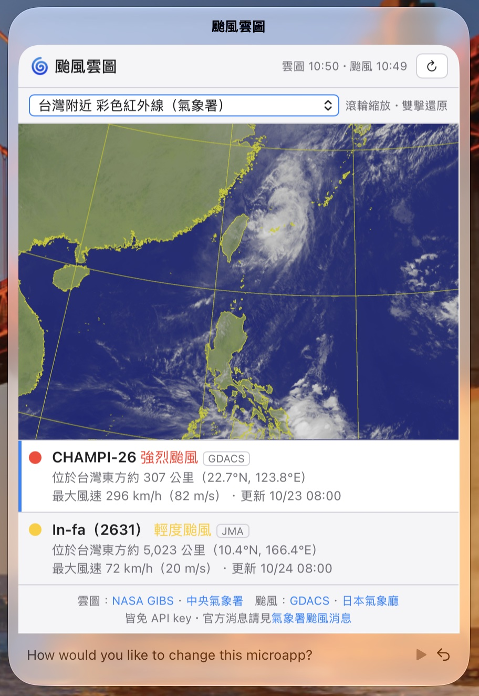

# Honu

[](https://github.com/ctchuang/honu/actions/workflows/ci.yml)

<p align="center">
  
</p>

An experiment in having Claude Code create microapps on the fly, right
on your macOS desktop. See [openhonu.ai](https://openhonu.ai).

> **Status:** experimental prototype. Expect breaking changes.
>
> **Safety:** there is no protection against prompt injection.

## What it does

Microapp bubbles float right on your desktop. A little turtle spits
them out; drag a bubble to the octopus to remove it.

Describe a new microapp to the turtle, and Claude makes it in moments.
To change a microapp, type what you want into the bar at its bottom.


Microapps can show live data. When a typhoon was coming, I asked for a
satellite map of Taiwan:

<p align="center">
  
</p>

## Quick start in 30 seconds

If you already have Claude Code installed, start `claude` in this folder
and ask it to run Honu. Claude will make sure everything works.

## Getting started (longer version)

### Install Claude Code (for making microapps)

Honu asks Claude through [Claude Code](https://claude.com/claude-code), running it
headless (`claude -p`) for each request, so it needs no API key: install Claude Code and
run `claude` once in Terminal to sign in with your Claude account. Honu finds `claude` in
your `PATH` or where it is usually installed, and leaves out any `ANTHROPIC_API_KEY` in its
environment, so answers always come through your account.

### Build and run

Honu needs **macOS 26** or newer and a Swift 6.2 toolchain. Xcode is not required: the
Command Line Tools are enough.

```sh
xcode-select --install   # if you have neither Xcode nor the Command Line Tools
swift run                # build and launch
```

### Using Honu

- **Click** the turtle for its launcher, and click a microapp: the turtle spits out a
  new bubble of it, such as one Claude made, or **+** to describe a new one for Claude
  to write. The microapps that come with Honu, such as **Note** and **Timer**, are in
  the **Reef** folder.
- To change a microapp, say what you want in the bar below it.
- **Drag** bubbles around, or throw them; crowded ones push each other aside.
- To delete a bubble, drag it to the octopus. To uninstall a microapp, drag it from the
  launcher there. Changed your mind? Click the octopus, or press <kbd>⌘</kbd><kbd>Z</kbd>.
- **Right-click** the turtle to keep Honu on just one desktop, or to quit. Clicks
  elsewhere pass through to your other apps.
- Everything is saved as you go.

The ideas behind this UI are in [docs/UI.md](docs/UI.md).

## Development

Work happens on the `dev` branch; `main` is kept stable. Please open pull requests
against `dev`, not `main`.

```sh
swift test                                           # run the tests
swift format lint --strict -r Sources Tests Package.swift   # lint
swift format -i -r Sources Tests Package.swift     # format
git config core.hooksPath .githooks                  # lint and test before each push
```

The pre-push hook in `.githooks/` runs the lint and the tests when a push changes
Swift code (`git push --no-verify` skips it). Claude Code also lints each Swift file
it edits, through the hook in `.claude/settings.json`.

```sh
swift build -c release   # optimized build
```

## License

[MIT](LICENSE)
