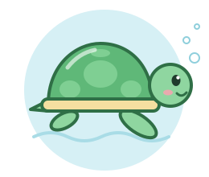

# Honu

<p align="center">
  
</p>

An experimental desktop GUI and Human-Computer-Interface project written in Rust with [egui](https://github.com/emilk/egui) / eframe.

> **Status:** experimental. This is a playground for trying out egui, not a finished application. Expect breaking changes.

## What it does

Omitted for now.

## Getting started

### 1. Install Rust

Honu needs a stable Rust toolchain that supports edition 2024 (Rust 1.85 or newer).
The easiest way to get one is [rustup](https://rustup.rs):

```sh
curl --proto '=https' --tlsv1.2 -sSf https://sh.rustup.rs | sh
rustup update stable   # if Rust is already installed
```

Honu is developed on macOS. It builds on other platforms too, but floating on the
desktop with click-through (see below) currently works only on macOS.

### 2. Add your Claude API key (for asking Claude)

Honu uses Claude to answer questions. Keep your key in a local `.env` file,
which git ignores:

```sh
cp .env.example .env
```

Then open `.env` and paste your key after `ANTHROPIC_API_KEY=`. You can create a key
in the [Claude Console](https://console.anthropic.com/settings/keys). Never commit
`.env` or put your key anywhere else in the repository; only the empty template
`.env.example` is tracked.

The **Ask…** item in the turtle's menu uses it. Without one, the Ask bubble asks you to
paste a key, which the desktop app keeps only until it quits. The web version keeps a
pasted key in that browser's local storage, since a web page cannot read `.env`.

### 3. Run

```sh
cargo run                # build and launch
cargo run -- --windowed  # launch in an ordinary window instead
cargo build --release    # optimized build
```

By default the bubbles float directly on your desktop, above other windows. Clicks
pass through to the apps below everywhere except on a bubble, the turtle, or the octopus. The window
has no close button: click a bubble or the turtle to focus Honu, then press
<kbd>⌘</kbd><kbd>Q</kbd> to quit (or quit it from the Dock).

`--windowed` shows the bubbles in a regular window with their own wallpaper, which is
handy during development.

### Using the bubbles

- Honu starts with just a little pixel turtle in the bottom-left corner. **Click** it to
  release the bubbles, and **drag** it to move it anywhere. It stays where you leave it,
  even after you quit and reopen Honu.
- **Right-click** or **long-press** the turtle for its menu: **Ask…** makes it spit out a
  bubble where you can ask Claude a question, and **Exit** quits Honu.
- **Drag** a bubble to move it, and **throw** it to let it glide.
- To delete a bubble, drag it to the pixel octopus that comes up in a bottom corner
  while you drag, and let go. Changed your mind? For a few seconds afterwards,
  **click** the octopus (or press <kbd>⌘</kbd><kbd>Z</kbd>) and it spits the bubble back.
- **Double-click** a bubble to open it into a panel; double-click its title or edge to
  close it again.

### In a web browser

Honu also runs as a web page, which is handy on an iPad or any machine without a
Rust GUI. It shows the bubbles in the page like `--windowed`; floating on the desktop
and the turtle's menu are desktop-only.

```sh
rustup target add wasm32-unknown-unknown
cargo install --locked trunk   # or: brew install trunk
trunk serve                    # then open http://127.0.0.1:8080
```

On a remote machine (such as a cloud dev box you reach from an iPad), run
`trunk serve --address 0.0.0.0` and open its port 8080 in the browser. `trunk build
--release` writes a static site to `dist/` that any web server can host.

## Development

```sh
cargo clippy --all-targets  # lint
cargo fmt                   # format
cargo test                  # run tests
cargo clippy --target wasm32-unknown-unknown  # lint the web build
```

## License

[MIT](LICENSE)
